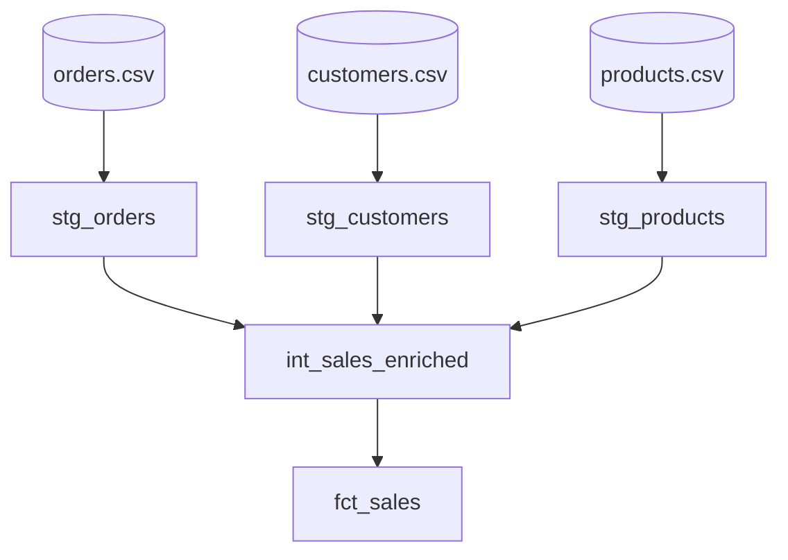

# Snowflake + dbt · Puzzle del Data Mart de ventas

> **Material para alumnos** · Charla Tech Riders · 30 minutos · Ejercicio semiguiado en Snowflake Workspaces.
>
> El proyecto se entrega **deliberadamente con cuatro errores pequeños**. No se necesita instalar dbt en el ordenador si se utiliza el entorno Snowflake Workspaces habilitado por el centro.

## Menú

| Recurso | Descripción |
|---|---|
| [Presentación (PDF)](presentacion/Snowflake_dbt_charla_12_slides.pdf) | Las 12 diapositivas de la charla |
| [Presentación (PPTX)](presentacion/Snowflake_dbt_charla_12_slides.pptx) | Versión editable |
| [Guía del alumno](docs/01_GUIA_ALUMNOS.md) | Preparación del entorno y resolución por etapas |
| [Pistas progresivas](docs/02_PISTAS.md) | Para desbloquearse sin ver la solución completa |
| [Entrega y criterios](docs/03_ENTREGA.md) | Cómo comprobar que el puzzle está resuelto |
| [Resolución de problemas](docs/04_PROBLEMAS_FRECUENTES.md) | Errores típicos de conexión, permisos y SQL |

## Historia de negocio

Una empresa de equipamiento para motoristas quiere analizar los pedidos que ya generan facturación.
Los CSV contienen pedidos, clientes y productos. Usaremos **dbt** para cargar esos datos como seeds, crear staging, combinarlos y construir el mart de ventas en Snowflake.

**Atención:** el DAG anterior es el **objetivo**, no necesariamente el DAG que mostrará el proyecto sin corregir. Identificar esa diferencia forma parte del ejercicio.

## Qué se debe conseguir

- Reparar **3 dependencias `ref()`** entre los modelos para reconstruir el DAG correcto.
- Corregir **1 regla de negocio** para no facturar pedidos cancelados.
- Ejecutar `dbt seed` y `dbt build` sobre un esquema propio o asignado.
- Mostrar el resultado del mart y explicar por qué el linaje tiene ese orden.

**Resultado esperado una vez corregido:** 3 pedidos facturables por **220,00 €**.

## Antes de empezar

1. Tener cuenta Snowflake, warehouse, rol, base de datos y un **esquema individual asignado** o creado con permisos adecuados.
2. Clonar el repositorio en tu cuenta GitHub/descargarlo, o abrirlo desde **Snowsight → Projects → Workspaces → From Git repository**, si el centro permite Git.
3. Personalizar los cuatro marcadores de [`profiles.yml`](profiles.yml) según tu entorno.
4. Seguir la [guía del alumno](docs/01_GUIA_ALUMNOS.md) por orden. No trabajes sobre el esquema de otro grupo.

**No hace falta realizar commits, gestionar snapshots ni administrar recursos de otros compañeros.** Esos aspectos pertenecen a la demostración del ponente.

## Avisos importantes

- **No incluyas credenciales en Git ni en capturas**. Los marcadores de `profiles.yml` no son contraseñas.
- El proyecto utiliza seeds (CSV) para que cada grupo cargue sus propios datos; no necesita acceso de escritura a tablas comunes.
- Si la configuración del aula no permite crear proyectos dbt en Workspaces, el profesor deberá habilitar un entorno o enseñar la solución con una demo. No hay un método universal de clonar/ejecutar sin permisos.

## Preparación en cuentas trial individuales

Cada participante crea sus propios recursos, sin depender de la cuenta del ponente. Empieza ejecutando [`setup/01_crear_entorno.sql`](setup/01_crear_entorno.sql) en un Worksheet de Snowflake; después sigue la [guía del alumno](docs/01_GUIA_ALUMNOS.md). Para comprobar el resultado, usa [`setup/02_verificar_resultado.sql`](setup/02_verificar_resultado.sql).

**Nota:** el script crea un warehouse X-Small que puede consumir créditos mientras está activo; se suspende automáticamente tras 60 segundos de inactividad. No compartas contraseñas, tokens ni claves en GitHub.
